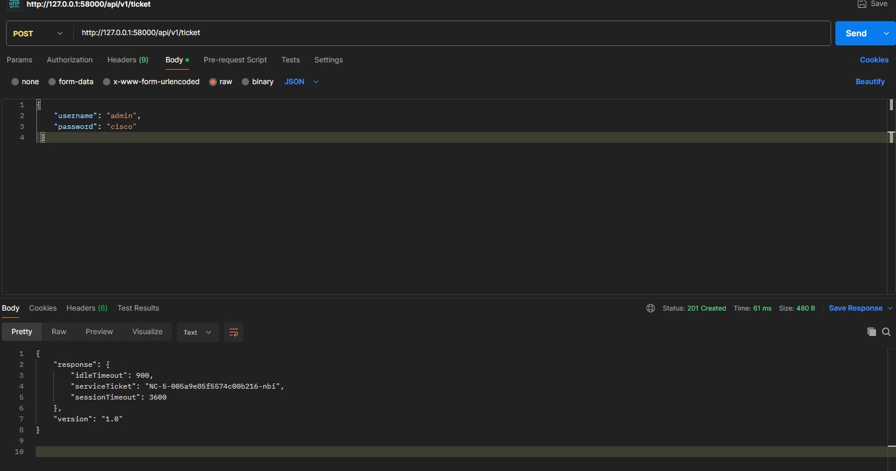
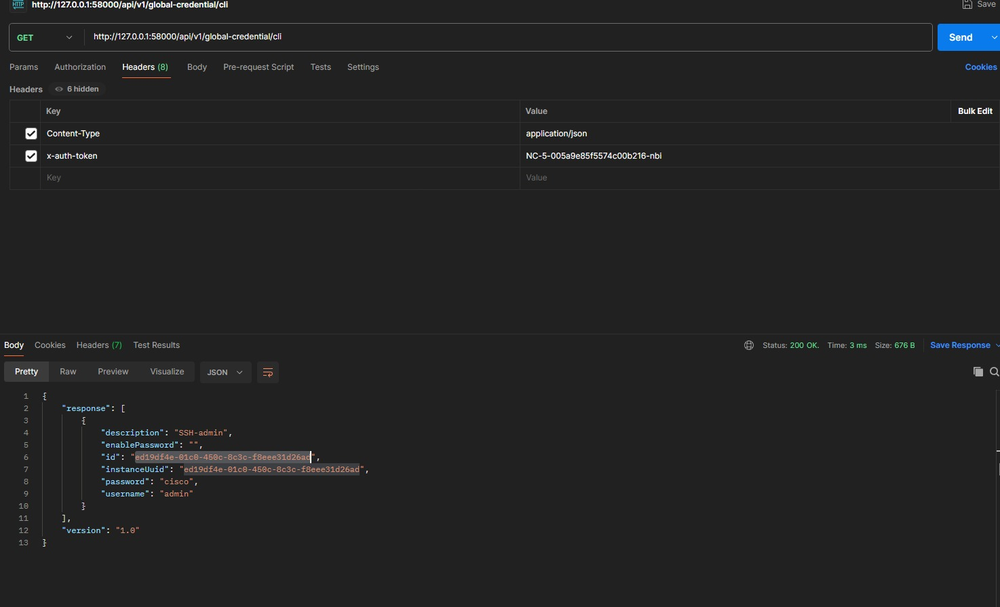
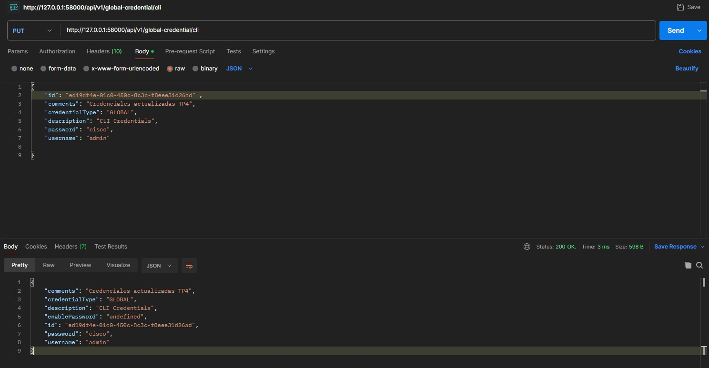
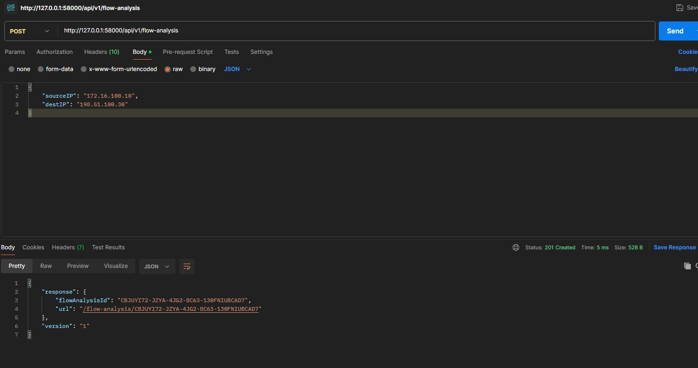
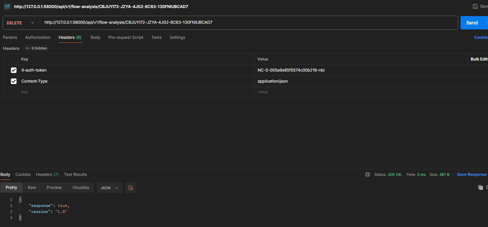

# API REST del Network Controller (Postman)

Base URL: `http://127.0.0.1:58000/api/v1` · Credenciales del NC (laboratorio): `admin` / `cisco`

Todas las requests (salvo `/ticket`) llevan los headers:

```
Content-Type: application/json
x-auth-token: <serviceTicket>
```

## 1. Obtener ticket — `POST /ticket`
```json
{ "username": "admin", "password": "cisco" }
```
Respuesta `201 Created` → `response.serviceTicket` (idle 900 s, sesión 3600 s).



## 2. Ver credenciales CLI — `GET /global-credential/cli`
Devuelve la credencial `SSH-admin` con su `id`, que se usa en el PUT.



## 3. Actualizar credencial — `PUT /global-credential/cli`
```json
{
  "id": "<id del GET>",
  "comments": "Credenciales actualizadas TP4",
  "credentialType": "GLOBAL",
  "description": "CLI Credentials",
  "password": "cisco",
  "username": "admin"
}
```
Respuesta `200 OK`.



## 4. Path trace — `POST /flow-analysis`
```json
{ "sourceIP": "172.16.100.10", "destIP": "198.51.100.30" }
```
PC1 (Edificio A) → Web server. Respuesta `201 Created` con `flowAnalysisId`.

> La captura es de la primera versión del `.pkt`, cuando PC1 tenía `172.16.100.10`. En la topología final PC1 es **`172.16.100.30`**: para rehacer la prueba, usar `"sourceIP": "172.16.100.30"`.



## 5. Borrar el análisis — `DELETE /flow-analysis/{flowAnalysisId}`
Respuesta `200 OK` · `"response": true`.


