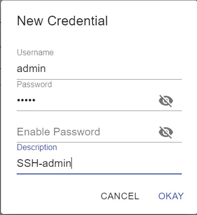
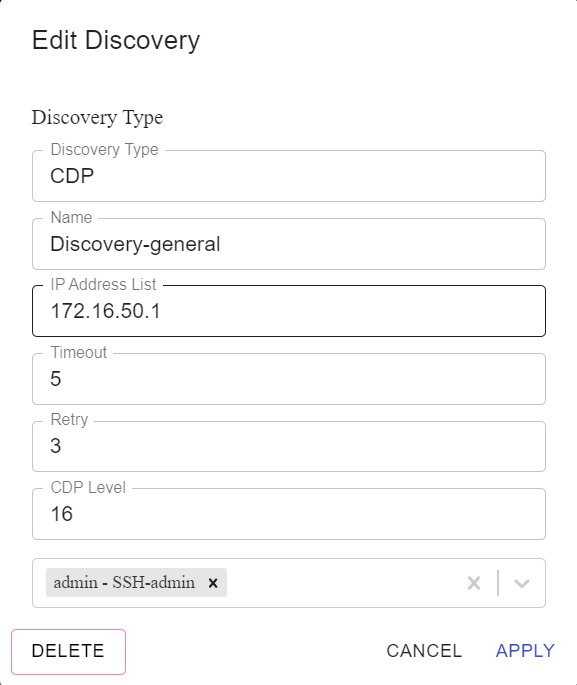
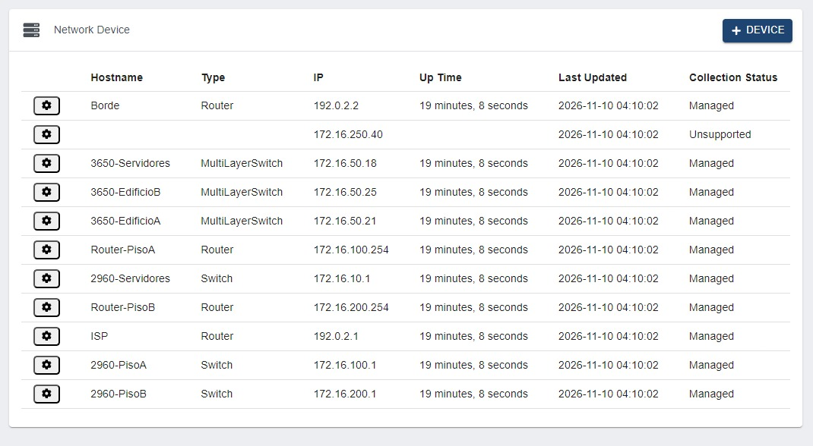
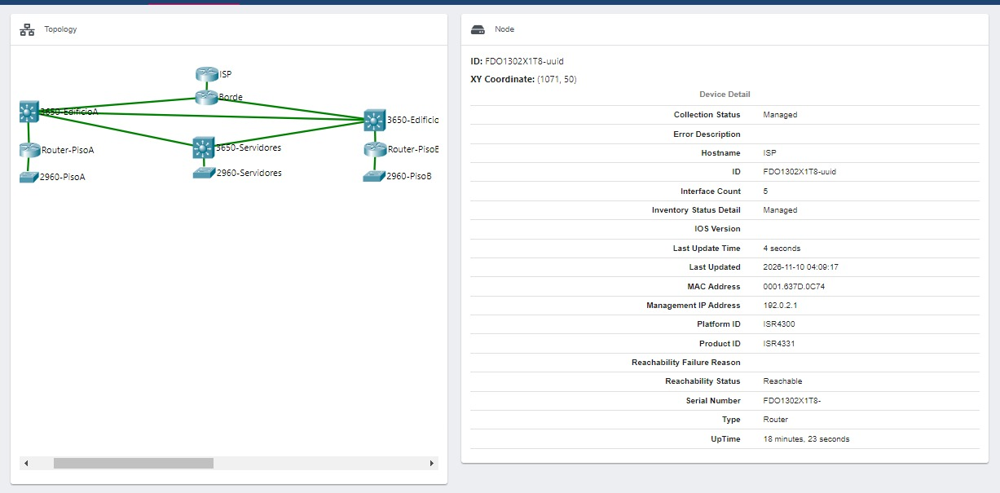
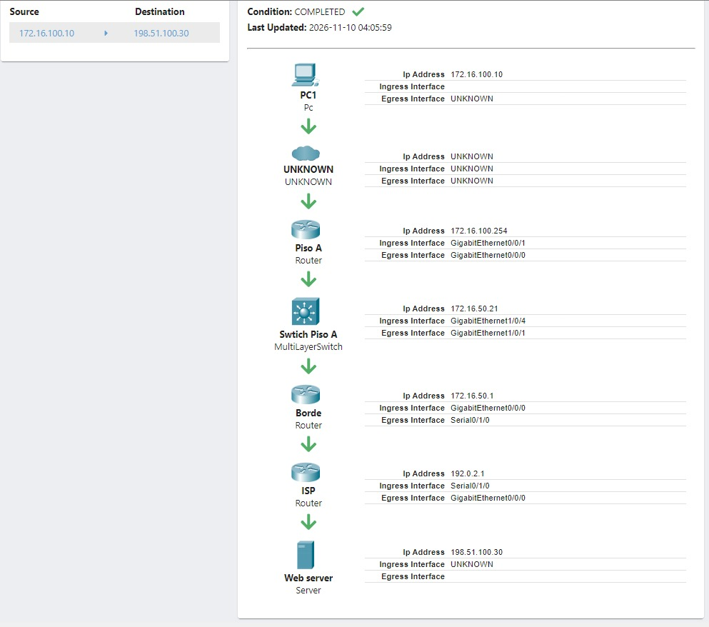

# Network Controller

**NC Principal:** `172.16.250.60/24` · `2001:DB8:10:250::60/64` · usuario `admin` / `cisco` · credencial CLI `SSH-admin` (`admin` / `cisco`).

## Inventario actual (`.pkt` final, verificado por la API el 22/11/2026)

| Hostname | Tipo | IP de gestión | Estado |
|---|---|---|---|
| Borde | Router | 192.0.2.20 | Managed |
| Router-PisoA | Router | 172.16.50.22 | Managed |
| Router-PisoB | Router | 172.16.50.26 | Managed |
| 3650-EdificioA | MultiLayerSwitch | 172.16.50.21 | Managed |
| 3650-EdificioB | MultiLayerSwitch | 172.16.50.25 | Managed |
| 3650-Servidores | MultiLayerSwitch | 172.16.50.18 | Managed |
| 2960-PisoA | Switch | 172.16.11.10 | Managed |
| 2960-PisoB | Switch | 172.16.12.20 | Managed |
| 2960-Servidores | Switch | 172.16.10.30 | Managed |
| *(ISP, sin hostname)* | — | 192.0.2.10 | **Wrong credential** |

Los 9 equipos del sistema autónomo quedan **Managed**. El **ISP** queda en **Wrong credential** porque no tiene configurado el usuario de la credencial CLI, como pide la consigna: no pertenece al AS.

Hosts que ve el controlador: DNS `.20`, NTP `.30`, FTP `.50`, PC3 `.100` (DHCP del 3650), PC0 y PC1 (`172.16.100.x`), PC2 y PC4 (`172.16.200.x`) y el web server `198.51.100.30`.

## Capturas de la primera entrega (antes de la corrección R1)

> ⚠️ Estas capturas son de la versión entregada originalmente: muestran IPs viejas, el ISP en **Managed** (el error que marcó la cátedra) y el NC secundario. Para el informe de la R1 hay que **reemplazarlas** por capturas del `.pkt` final.

| | |
|---|---|
|  |  |

### Path trace: PC1 → Web server
PC1 → Router-PisoA → 3650-EdificioA → Borde (Se0/1/0) → ISP → Web server `198.51.100.30`. Estado: **COMPLETED**. En la captura PC1 figura como `172.16.100.10`; en la topología final es `172.16.100.30`.

Los 2960 aparecen como *UNKNOWN* en el path trace porque el trazado es de capa 3 y los 2960 trabajan en capa 2.

