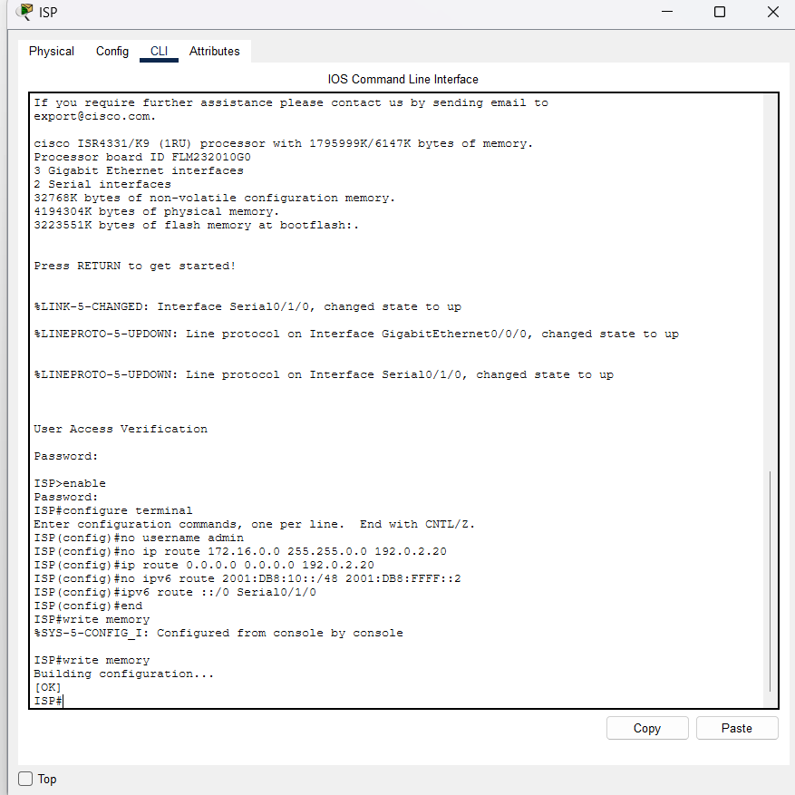
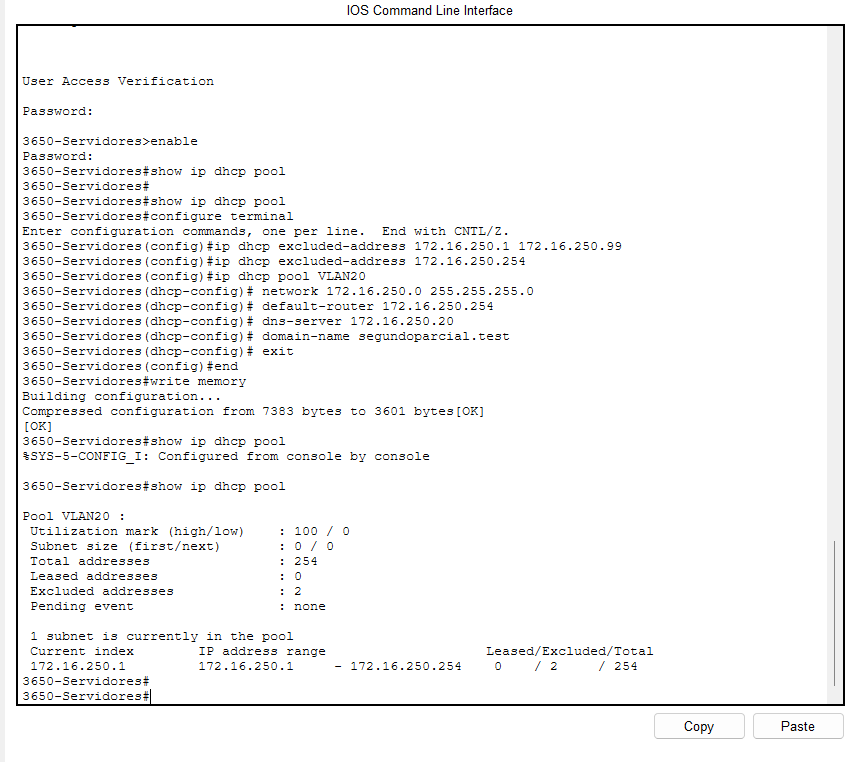
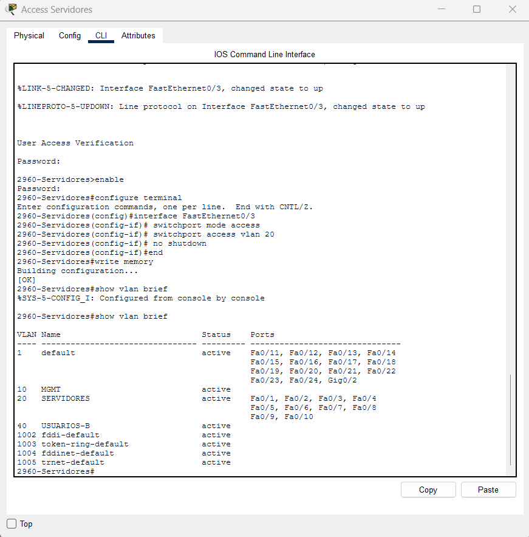
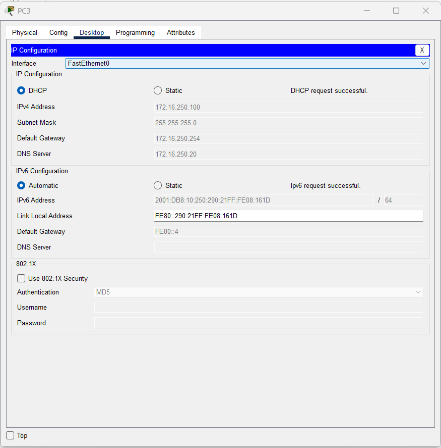
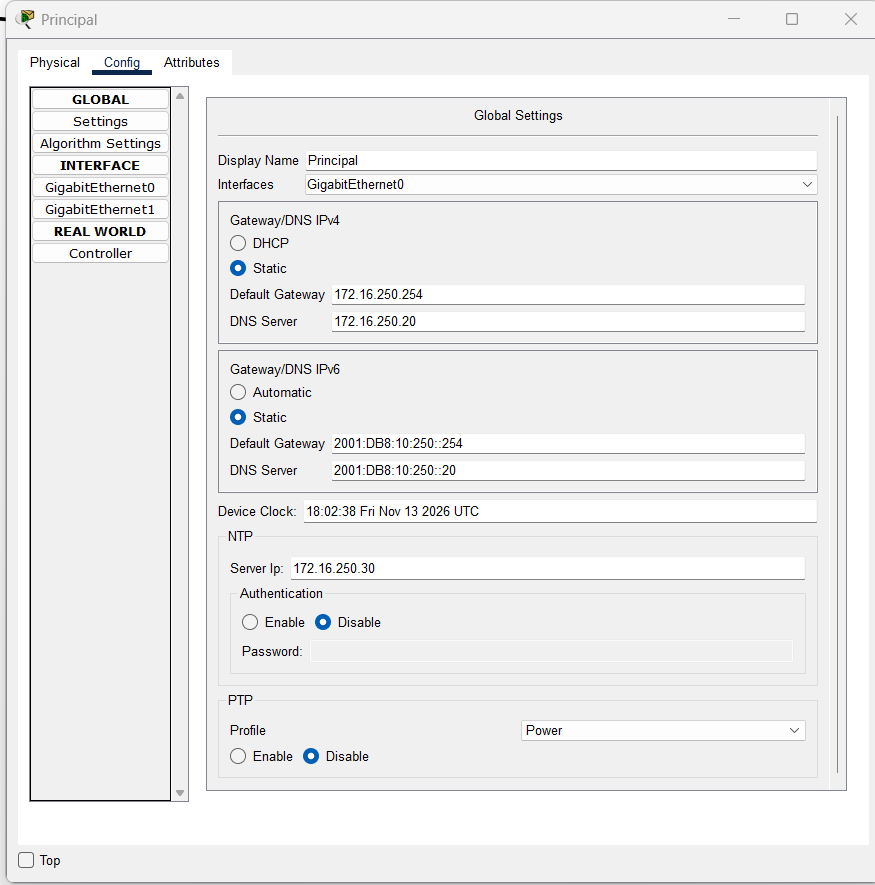
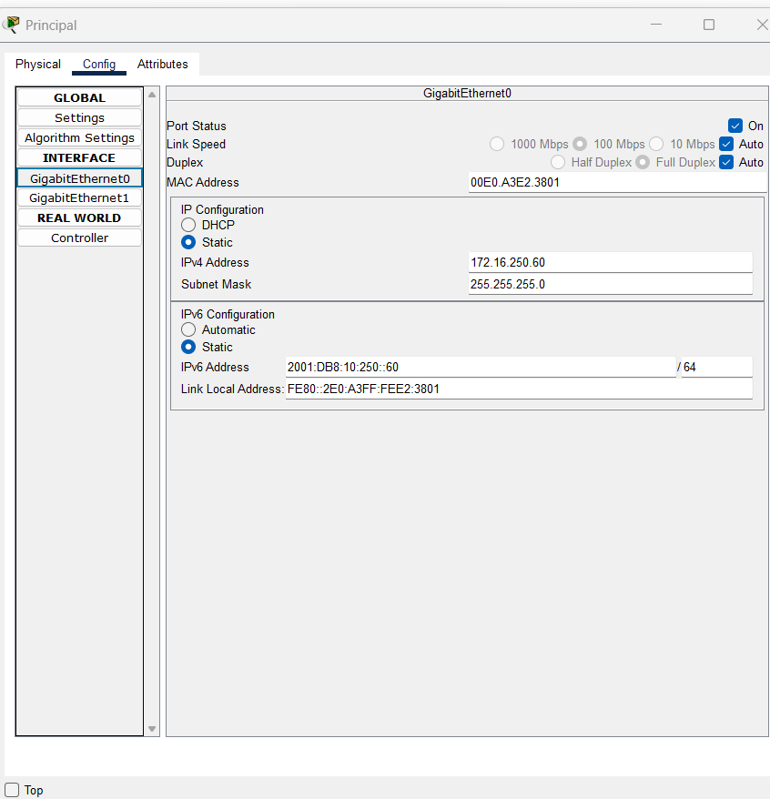
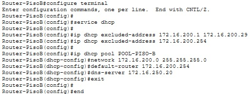
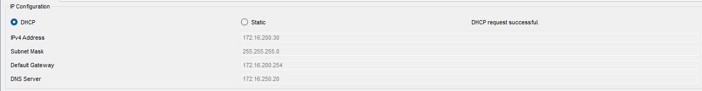
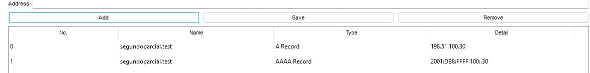

# Capturas de consola y configuración

| Captura | Qué muestra |
|---|---|
|  | **ISP**: se quita `username admin` (queda *Wrong credential* en el NC) y se configuran las rutas default IPv4 (`0.0.0.0/0 → 192.0.2.20`) e IPv6 (`::/0 → Serial0/1/0`) hacia Borde. |
|  | **3650-Servidores**: pool DHCP `VLAN20` (`172.16.250.0/24`, gateway `.254`, DNS `.20`, dominio `segundoparcial.test`) y `show ip dhcp pool`. |
|  | **2960-Servidores**: el puerto Fa0/3 en la VLAN 20 SERVIDORES, para el cliente DHCP, y `show vlan brief`. |
|  | **PC3**: recibe `172.16.250.100/24` por DHCP del 3650 (gateway `.254`, DNS `.20`) y su IPv6 por SLAAC en `2001:DB8:10:250::/64`. |
|  | **NC Principal**: gateway y DNS en IPv4/IPv6, y servidor NTP `172.16.250.30`. |
|  | **NC Principal**: interfaz `172.16.250.60/24` y `2001:DB8:10:250::60/64`. |
|  | **Router-PisoB (4331)**: pool DHCP `POOL-PISO-B` (`172.16.200.0/24`, gateway `.254`, DNS `172.16.250.20`), con `.1`–`.29` y `.254` excluidas. |
|  | **PC de Piso B**: recibe `172.16.200.30/24` por DHCP del Router-PisoB (gateway `.254`, DNS `172.16.250.20`). |
|  | **Servidor DNS**: registros A (`198.51.100.30`) y AAAA (`2001:DB8:FFFF:100::30`) para `segundoparcial.test`. |
